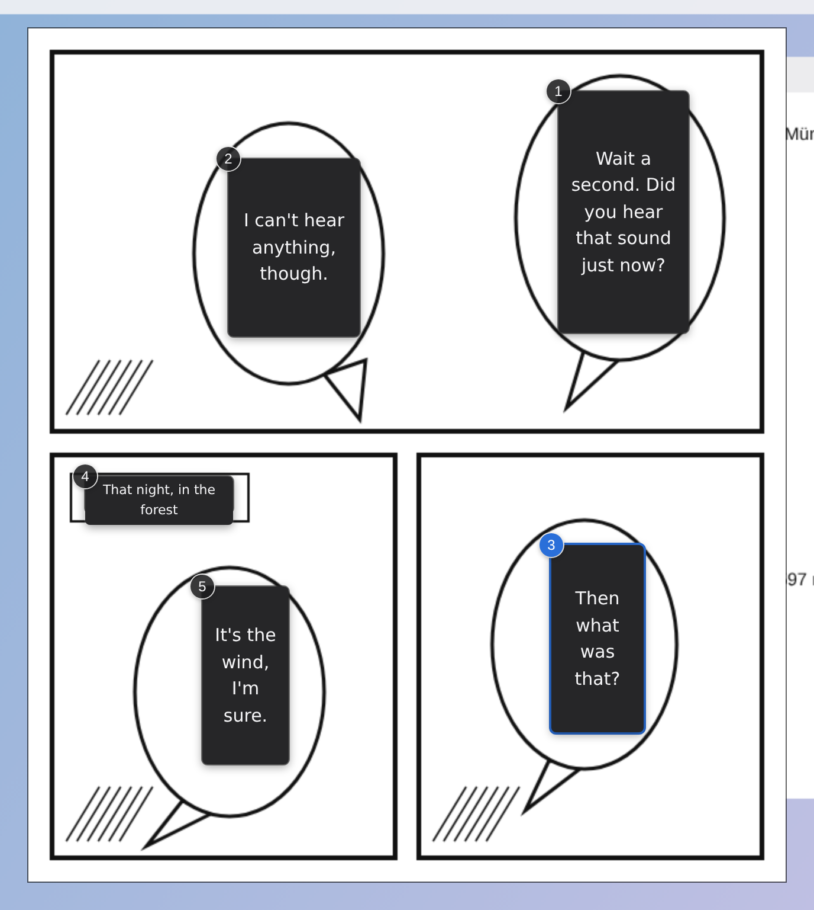
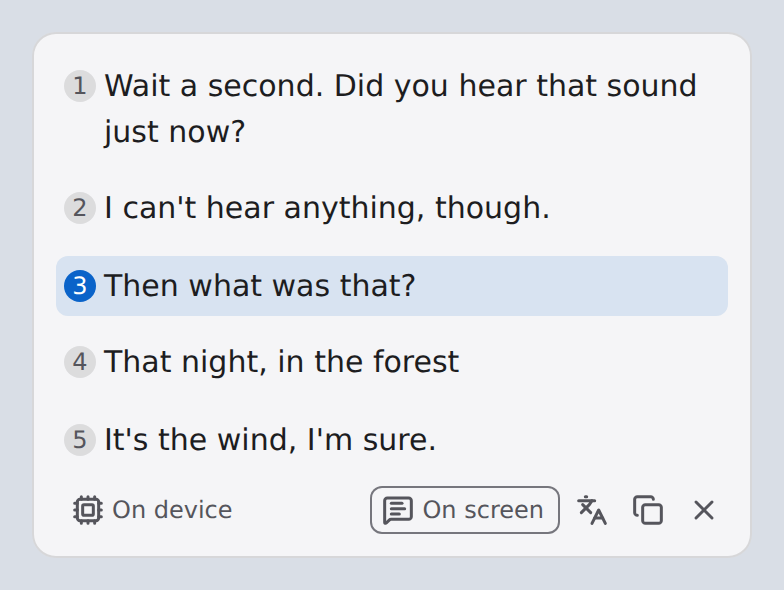
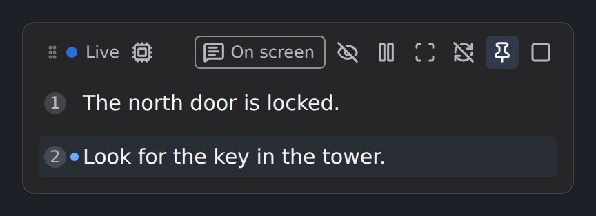
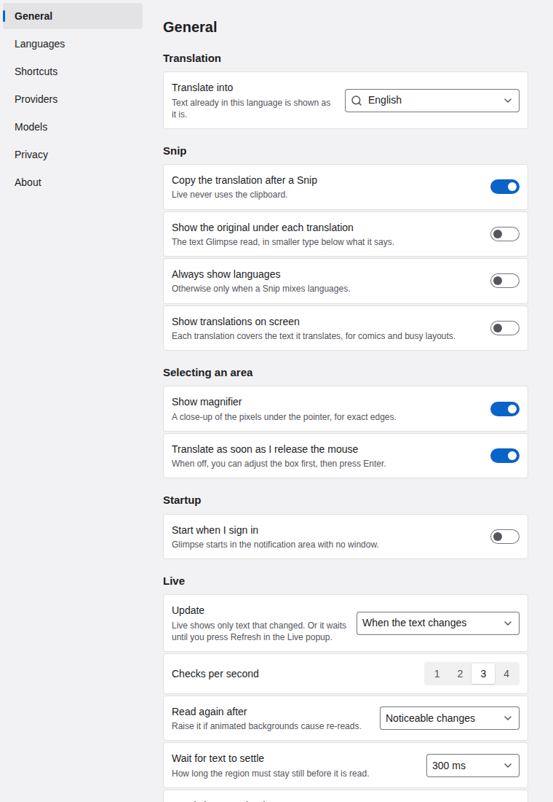

# Glimpse

Select any area of your screen and read what it says in your own language. Glimpse reads the
text in the region (OCR), works out which language each block is in, and translates it next to
where it appeared. It runs on your computer: the default OCR and translation engines are local,
so nothing you translate leaves the machine unless you choose a cloud provider yourself.

For Windows 10 (version 2004) or later on x64, and macOS 14 Sonoma or later on Apple Silicon.
Glimpse is an early preview (0.0.x): it works end to end, but expect rough edges. Builds are
not code-signed (see [Install](#install)).

## What it looks like

| On screen: translations laid over a comic's speech bubbles | Snip: numbered translations, linked to the bubbles |
|---|---|
|  |  |
| **Live:** a movable, pinnable popup that follows a region | **Settings** |
|  |  |

The screenshots are the app's own interface code rendered in a test harness, so they match the
shipped UI; the comic is a sample from [docs/samples/](docs/samples/).

## Features

- **Snip:** press a shortcut (Windows `Alt+Shift+S`, macOS `⌃⇧S`), drag a box over any text, and
  the translation appears next to it. Text boxes show first, then the translation fills in. By
  default the translation is also copied to the clipboard.
- **Live:** pin a region (Windows `Alt+Shift+L`, macOS `⌃⇧L`), for example a game's dialogue box
  or a subtitle strip. Glimpse watches it a few times a second and translates again only when
  the text has changed and settled. One popup stays docked to the region and updates in place.
  Live never touches the clipboard.
- **Language per block:** each block's language is detected on its own, so a region mixing
  Japanese and German gets both translated. You can limit translation to chosen source
  languages; everything else is folded into a "blocks skipped" line, never hidden silently.
- **Many scripts:** OCR for Chinese, Japanese and Latin-script languages is included; Korean,
  Cyrillic, Arabic, Devanagari, Thai, Greek, Tamil and Telugu recognition models can be
  downloaded in Settings › Models. Right-to-left text is supported.
- **Private:** in Private mode translations aren't remembered in Glimpse's cache. The cache is
  also wiped after a period of inactivity and when the screen locks.
- **On screen:** for comics and busy layouts, each translation can be drawn right over the text
  it translates (the **On screen** button in Snip and Live, or the tray). Otherwise numbered
  markers link each bubble to its line in the popup.
- **Out of the way:** a tray / menu-bar app with no main window. It never reads its own windows.
  They show up in screen sharing and recordings (Discord, OBS) unless you turn that off in the
  tray or Settings › Privacy.
- **Your keys, your choice:** optional cloud providers with your own API key, stored in the OS
  keychain (see [Cloud providers](#cloud-providers)).

## Install

Step-by-step instructions, including each warning an unsigned build triggers, the macOS
Screen Recording permission and what you agree to: **[docs/install.md](docs/install.md)**.

Trying a test build? **[docs/mvp-test.md](docs/mvp-test.md)** says how to set it up and has a
checklist with sample pages to snip.

In short:

1. Download from the [Releases page](https://github.com/Abdul-213/glimpse/releases):
   `glimpse-<version>-windows-x64-setup.zip` (installer) or `-windows-x64.zip` (portable) for
   Windows, `glimpse-<version>-macos-arm64.dmg` or `.zip` for a Mac. `SHA256SUMS` lets you check
   the download.
2. The builds aren't code-signed or notarized yet. Windows SmartScreen asks first (*More info*
   → *Run anyway*). On macOS, move Glimpse to Applications, open it once, then allow it in
   System Settings → Privacy & Security → *Open Anyway*. Details in
   [docs/install.md](docs/install.md).
3. On first launch Glimpse unpacks itself, so the first start is slower. On macOS it asks for
   the Screen Recording permission the first time it captures.
4. Translation packs for your languages are downloaded once, with your consent, from Mozilla;
   after that Glimpse works offline.

There is no Intel Mac build yet (onnxruntime-node ships no Intel macOS binary) and no Linux
release.

## Privacy

Glimpse is built to keep what's on your screen on your computer.

**By default, nothing you capture or translate leaves the machine.** OCR (PaddleOCR on ONNX
Runtime) and translation (Firefox Translations / Bergamot) run locally. There is no Glimpse
account, server or analytics.

What Glimpse does connect to, and when:

| Connection | When | What is sent |
|---|---|---|
| Mozilla (`firefox.settings.services.mozilla.com`, `firefox-settings-attachments.cdn.mozilla.net`) | When you download a translation pack | A normal file download request |
| ModelScope (`www.modelscope.cn`) | When you download an extra OCR recognition model | A normal file download request |
| GitHub (`api.github.com`) | At most once a day, to see whether a newer release is out. Turn it off in Settings › About › *Check for updates*. | A request for the latest release, with a `Glimpse/<version>` user agent |
| A cloud provider you set up | Only when you pick it in Settings › Providers and confirm | See [Cloud providers](#cloud-providers) |

Each of these is an ordinary HTTPS request, so the server sees your IP address.

Also:

- ONNX Runtime's official builds include Microsoft telemetry, on by default. Glimpse switches
  it off before the OCR engine loads, so no usage data or device id is created or sent
  ([GLIM-112](docs/decisions/GLIM-112-onnxruntime-telemetry.md)).
- Logs stay on your computer. They never contain text from your screen or API keys, and
  diagnostics are only copied when you click *Copy diagnostics*.
- API keys are kept in the OS keychain (macOS Keychain, Windows Credential Manager), never in a
  settings file, and never shown again after you save them.

## Cloud providers

Cloud providers are optional and off by default. You bring your own key; Glimpse never proxies
requests or adds an account of its own. Supported today, with one Google Cloud API key:

| Provider | Used for | What it receives |
|---|---|---|
| Google Cloud Translation (Basic, v2) | Translation | The text Glimpse recognised in the region, with the source and target language codes. Not the image. |
| Google Cloud Vision | OCR | An image of the region you selected. |

The recommended setup is local OCR with cloud translation: only text goes to Google. Cloud OCR
sends a picture of the region, including anything in it that isn't text, and in Live mode it
sends every changed frame, so it is best kept for Snip.

Choosing a cloud provider in Settings › Providers asks you to confirm first. While one is in
use, Glimpse says so: the tray's status line names a cloud translator, and a popup whose result
came from the cloud shows the provider's name. Google's own terms apply to what you send; at the time of writing Google states it
does not use this content to train its models (see
[GLIM-22](docs/decisions/GLIM-22-cloud-providers.md) for the details we checked). You pay Google
for usage beyond its free tiers.

## Running from source

You need [Bun](https://bun.sh) 1.4.4 and [Hutch](https://hutch.blackboard.sh) (Electrobun's CLI).
Windows 10 also needs the WebView2 runtime (Windows 11 has it).

```sh
curl -fsSL https://hutch.blackboard.sh/hutch/install.sh | sh   # Windows: see CONTRIBUTING.md
bun install
bun run devkit          # fetch the pinned Electrobun devkit

# Screen capture needs the native helper, built once per OS:
sh app/native/macos/build.sh            # macOS (Xcode Command Line Tools)
pwsh app/native/windows/build.ps1       # Windows (MSVC or zig)

bun run dev             # build the views and launch Glimpse with rebuild-on-change
```

Glimpse starts in the tray / menu bar. Press `Alt+Shift+S` (macOS `⌃⇧S`) and drag over
[docs/mvp-sample.png](docs/mvp-sample.png) for a first Snip. On Linux there is no capture, but
`bun test` and the headless harness (`bun run harness snip|live`) run the whole pipeline on
recorded frames.

## Building from source

See [CONTRIBUTING.md](CONTRIBUTING.md) (setup, commands, CI builds, releases) and
[ARCHITECTURE.md](ARCHITECTURE.md). Changes are listed in [CHANGELOG.md](CHANGELOG.md).

## Licences and third-party notices

Glimpse is licensed under the [MIT License](LICENSE).

It ships or downloads third-party components under their own licences. The full list, with
versions, sources and licence texts, is in [`app/models/NOTICE.txt`](app/models/NOTICE.txt) and
[`app/models/licenses/`](app/models/licenses/) (shipped inside the app as `models/NOTICE.txt`):

| Component | Licence |
|---|---|
| PaddleOCR PP-OCRv5 models (PaddlePaddle), ONNX conversions by RapidOCR | Apache-2.0 |
| bergamot-translator (WebAssembly) | MPL-2.0 |
| Firefox Translations language models (downloaded on demand) | MPL-2.0 |
| ELD language detector | Apache-2.0 |
| ONNX Runtime (onnxruntime-node) | MIT |
| Microsoft Visual C++ runtime DLLs (Windows builds only) | Microsoft Visual Studio licence terms, "Distributable Code" ([GLIM-111](docs/decisions/GLIM-111-msvc-runtime.md)) |

The app is built with [Electrobun](https://github.com/blackboardsh/electrobun) and runs on
[Bun](https://bun.sh); the interface uses [Solid](https://www.solidjs.com/) and
[Tailwind CSS](https://tailwindcss.com/). Their licences come with their packages.
